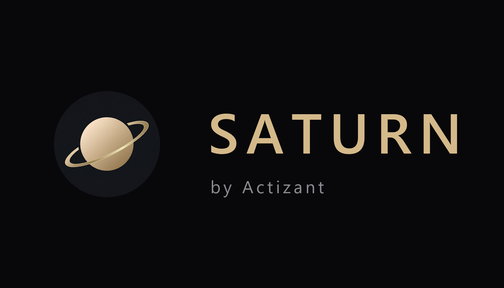

# Saturn

<div align="center">



**Not another chatbot. A local-first AI companion that lives on your desktop, sees your screen, hears your room, and builds its own tools.**

[](https://python.org)
[](https://riverbankcomputing.com/software/pyqt/)
[](https://ai.google.dev/)
[](https://modelcontextprotocol.io/)
[](https://microsoft.com/windows)
[](LICENSE)

</div>

---

## The idea

Most assistants answer you and then forget. **Saturn** stays. It lives on your machine, watches the same screen you do, listens through the same microphone, and *acts* — opening apps, wiring circuits, editing documents, driving a browser, talking to your phone. When it meets a task it cannot already do, it writes the missing tool itself, tests it in a sandbox, and keeps it. Your copy of Saturn at the end of a week is genuinely larger than at the start.

Everything runs against your own API key and your own hardware. Nothing about your machine leaves it unless you ask.

---

## What it can do

**Start your day with a spoken briefing.**
Saturn wakes with the truth, not templates: live weather for your city, Nifty / Sensex / Bitcoin quotes, today's calendar, local and world headlines — then walks through it sentence by sentence, out loud, lighting up each card as it speaks.

**Talk and see, in real time.**
Full-duplex voice over Gemini Live, plus live webcam and screen vision — read a contract, debug a stack trace on your monitor, or identify the part sitting on your desk. Say *"see me"* and it opens the camera, recognises **you** on-device (a local face descriptor, never a photo), greets you by name and describes the people in frame — you, a friend who's enrolled, even a stranger it won't presume to name — not just the room.

**Vibe with whatever you're playing.**
Saturn has a third ear. It listens to the music already coming out of your own speakers — knowing the track from its window title and *feeling* its energy through an optional audio loopback — so the orb pulses to the beat, it reacts out loud to a good pick, and it quietly learns your taste. A loopback only opens while music actually plays, and the audio is analysed locally, never uploaded.

**Build the tool it's missing.**
Ask for something outside its toolkit and Saturn recognises the gap, authors a new Python capability, runs it through an isolated Crucible sandbox, and hot-registers it. No restart, no plugin store. Each forged tool declares what it needs — network, files, commands — and every call is approval-gated: allowed verbs run free, risky ones ask first, blocked ones refuse. No pretending otherwise.

**Keep a creators' shelf — and a toolbox.**
The CREATORS page lists every capability Saturn has grown or been given: what goal it was forged from, which version it's on, its full call audit trail, and a permission row per verb (Always allow / Ask each time / Block). A safety bar holds the global kill switch and a cap on how many forged servers stay awake at once. The CREATOR TOOLS page runs the machine side: your developer workspace and a grid of every MCP server you've hand-configured, hot-plugged live with a trust dialog — connect, disconnect or remove without editing JSON.

**Run your tasks like an operator.**
A dedicated Tasks workspace shows what's running, what's waiting on your approval, what failed and why — step by step, with logs and the files each task produced.

**Reason about hardware.**
Point it at a breadboard or describe a part over voice and it maps microcontrollers, sensors and passives, then draws animated pin-to-pin wiring with ready-to-flash Arduino firmware in a glowing on-screen HUD.

**Work with documents.**
Draft Word reports and résumés, assemble Excel models with live formulas and charts, lay out branded slide decks, and merge, split or extract PDFs.

**Reverse engineer anything.**
Point it at a live website and it lifts the DOM, maps the API surface, then rebuilds a clean working clone with a mock backend. Hand it a `.exe`, an Electron app or a `.wasm` and it extracts binary layout, security mitigations and function pseudocode — full evidence preserved, target content quarantined as untrusted.

**Move around the world.**
A WebGL globe with live flight tracks, great-circle routes, driving directions, ISS passes, earthquake and weather layers, and nearby-place search.

**Hold context across sessions — and show its work.**
A local memory cortex keeps your preferences, projects and instructions, with a Memory Inspector so you can see exactly what Saturn remembers and why. Your phone links through the Saturn Connect companion to screen calls, take notes, and hand transcripts to your desktop.

**Tend the house and the machine.**
Tuya / Home Assistant device control, Spotify through an official MCP server, permissive app and window management, a clipboard sentry, and a background auto-heal loop that patches its own runtime errors instead of crashing.

---

## Getting started

You'll need Windows 10/11 (64-bit), Python 3.11 or 3.12, Git, a microphone, and a [Google AI Studio](https://aistudio.google.com/) key. A webcam is optional but unlocks vision.

```powershell
git clone https://github.com/Actizant/Saturn-Ai.git
cd Saturn-Ai
python setup.py        # or double-click start_saturn.bat
```

Open **Settings** in the top bar, drop in your Gemini key (and any optional Spotify / weather credentials), then **Save & Connect**.

A few things to say:

| Try it for | Say / type |
| :--- | :--- |
| Morning briefing | *"Saturn, give me my briefing."* |
| Wiring help | *"Saturn, how do I connect a DHT11 to an Arduino Pro Mini?"* |
| Screen reading | *"Look at the parts on my screen and tell me how to assemble them."* |
| See & know you | *"Saturn, open the camera and see me."* |
| Self-extension | *"Saturn, learn a skill that tracks the International Space Station."* |
| Media | *"Play Starboy on Spotify."* |
| Documents | *"Build me a project roadmap in Excel."* |
| Housekeeping | *"Free up memory and close the heaviest apps."* |

---

## How the project is laid out

```
Saturn-Ai/
├── main.py                 # entry point + live event loop
├── ui.py                   # PyQt6 shell: command centre rail, waveform, HUD,
│                           #   chat, briefing, tasks, memory inspector,
│                           #   creators shelf, creator tools, settings
├── actions/                # the built-in capability tools
│   ├── circuit_assembler.py
│   ├── geospatial_globe.py
│   ├── auto_heal_engine.py
│   └── office_builder.py
├── core/                   # engine: prompt, memory, skills, registry, identity
│   ├── briefing_sources.py # live weather / markets / news for the briefing
│   ├── music_sense.py      # the third ear: what's playing on your speakers
│   ├── face_id.py          # on-device face detection, matching & identity
│   ├── skill_forge.py      # capability synthesis
│   ├── skill_crucible.py   # isolated trial sandbox
│   ├── mcp_forge.py        # forges a missing tool into a live MCP server
│   ├── permissions.py      # declared-needs, risk, Always/Ask/Block gating
│   ├── audit_log.py        # persistent per-call audit trail
│   ├── creators_catalog.py # the truth the creators pages read
│   └── identity.py         # persona + behavioural core
├── features/               # tools Saturn has grown itself
├── skills/                 # loadable skill packs
├── smart_home/             # device providers + discovery
└── brahma-connect-android/ # the phone companion
```

---

## Data & privacy

Saturn keeps its whole world on your disk — memory, credentials and settings live under `%LOCALAPPDATA%\SaturnAI\` and are never uploaded. API keys are encrypted at rest with Windows DPAPI, bound to your user account, and decrypt transparently for the app. Face identity is a local 128-number descriptor — never a photograph — and music you play is analysed on-device through a speaker loopback, not sent anywhere. Camera and microphone frames stream only while you are actively talking. Tools Saturn forged for itself only ever get the access they declared at forge time, every call is logged locally, and one switch turns them all off. See [PRIVACY_POLICY.md](PRIVACY_POLICY.md), and read [SECURITY.md](SECURITY.md) before exposing the local gateway to a network.

## License

Licensed under the **Apache License, Version 2.0** — free to use, study, modify and redistribute, even commercially, as long as you keep the license and copyright notice and mark the files you changed. Full terms in [LICENSE](LICENSE). The Saturn name and logo are **not** licensed by Apache and stay protected by [TRADEMARK.md](TRADEMARK.md).

## Contributing

Found a gap? Open an issue or send a pull request — contributions are welcome and reviewed by the maintainers. Please read [CONTRIBUTING.md](CONTRIBUTING.md) first, especially how contributions interact with the license.

---

<div align="center">

<b>Saturn</b> · by <b>Actizant</b> · Shreshtha Das & Soumwadeep Guha

</div>
